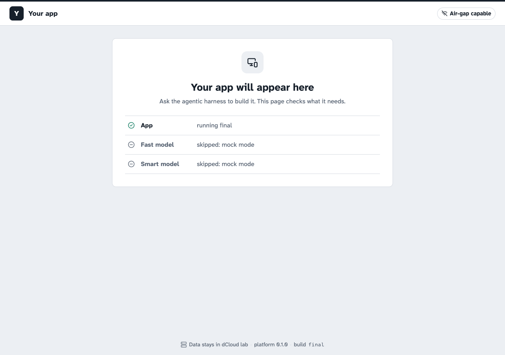
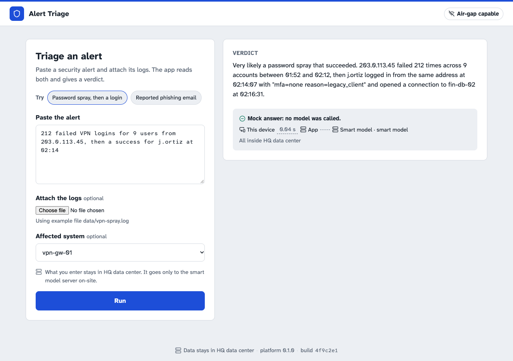
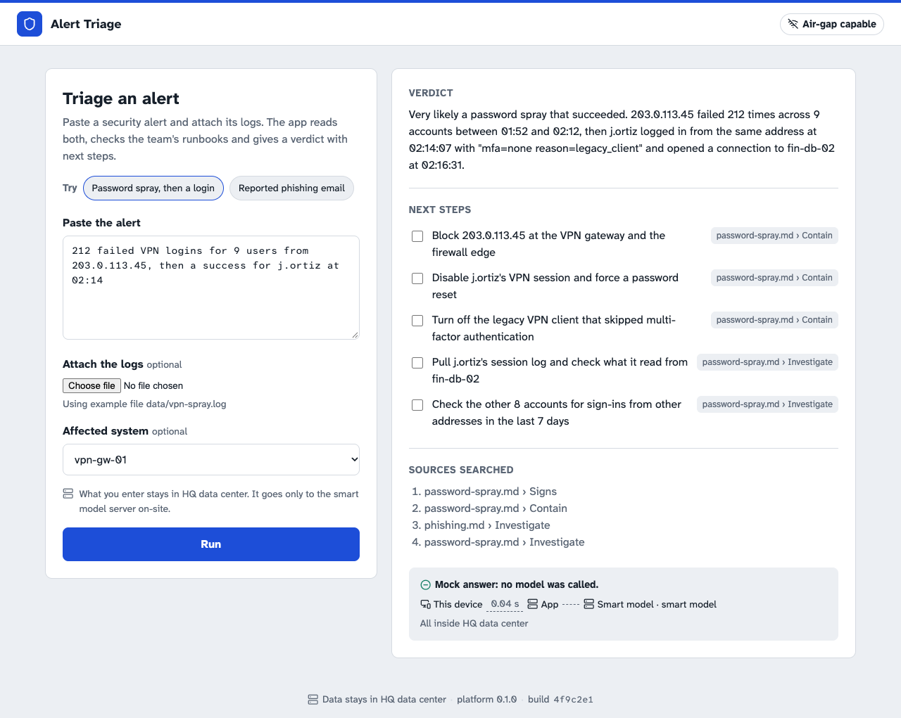
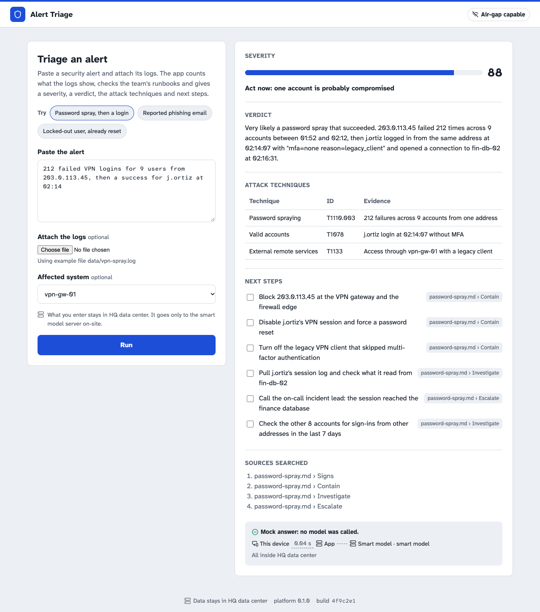

# Build your team's app: lab guide

You build a working AI app by typing a few plain-language requests to an agentic harness. It
writes the app, checks it, and publishes it to your team's app URL. You never edit code yourself,
and you don't need to know how.

The worked example is **Alert Triage**: a security analyst pastes an alert and its logs, and the
app returns a severity score, a verdict, the attack techniques and next steps from the team's
own runbooks. Every part of it runs on-site, on the lab's own models.

Values in `<angle brackets>` come from your lab page.

## Before you start

- You have: your lab user (`<user N>`), your team number (`team-<N>`), and the address of the
  harness on your VM (`<harness URL>`).
- One person per team types the prompts; the others watch the app URL and try the examples.
- Use only the made-up sample data in this repo. Never paste real alerts, logs, customer,
  patient or employee data.

## Step 0: see your app's placeholder

1. Open your team's app URL, `<your app URL>`, in a browser. If you don't have it yet,
   do step 1 below and ask the harness: *What is my app URL?*
2. You see **Your app will appear here** and three checks:

   | Row | Green means | If it is not green |
   |---|---|---|
   | App | The app is running; it shows the build it is on | Wait a minute and refresh |
   | Fast model | The fast tier answered | Amber `unreachable` or `not served`: tell the lab staff |
   | Smart model | The smart tier answered | Same as above |

   Grey **skipped: mock mode** means the app is running without models, for rehearsals.



## Step 1: open the harness

1. Open `<harness URL>` in your browser. It is already working in your team's repo, with the
   rules (`AGENTS.md`) and the how-to (`skills/base-app/SKILL.md`) loaded.
2. Start a new chat. Check it with: *Which folder may you edit, and what is my app URL?* It
   should answer `app/` and your team's app URL.

## Step 2: build the app (prompt 1)

Copy the whole block and send it:

```text
Build an app called Alert Triage for the HQ security team. Use the shield mark, brand color
#1D4ED8 and site "HQ data center".

Give it one screen, "Triage an alert", in the review layout with the smart model. Inputs:
- "Paste the alert": long text
- "Attach the logs": an optional file (.log, .txt or .csv)
- "Affected system": an optional select filled from data/assets.csv
The answer is one text block, "Verdict": two or three sentences on what most likely happened,
how sure you are and why, quoting the log lines that matter with their timestamps.

Make up the sample data, using only 192.0.2.0/24, 198.51.100.0/24 and 203.0.113.0/24 addresses
and invented names:
- data/assets.csv with columns hostname, role, owner, criticality, location and six systems:
  vpn-gw-01 (VPN gateway), mail-01 (mail relay), dc-01 (domain controller), fin-db-02 (finance
  database), web-ext-01 (public website) and hr-laptop-114 (an HR laptop).
- data/vpn-spray.log, about 230 lines like
  "2026-11-24T01:52:08Z vpn-gw-01 auth user=a.chen src=203.0.113.45 result=FAIL reason=bad_password":
  normal logins from 198.51.100.x, then 212 failures for 9 users from 203.0.113.45 between 01:52
  and 02:12, then a success for j.ortiz from that address at 02:14:07 with mfa=none
  reason=legacy_client, and a connection from that session to fin-db-02 at 02:16:31.

Add two examples, each with a mock answer:
- "Password spray, then a login": the alert "212 failed VPN logins for 9 users from
  203.0.113.45, then a success for j.ortiz at 02:14", the spray log and vpn-gw-01.
- "Reported phishing email": the alert "m.reyes reported an email from
  payroll-update@examp1e-hr.example asking staff to confirm bank details through a link",
  no logs, and mail-01.
```

The harness writes the app's files in `app/`, runs `make check`, pushes, waits for the new
build, and reports your app URL with timings. That takes a few minutes. Then:

1. Refresh your app URL. The placeholder is replaced by **Triage an alert**.
2. Click the example **Password spray, then a login**. You get a verdict.
3. Look under the answer: **Answered on-site in … s**, with the path from this device to the
   app to the smart model, all inside the site.



## Step 3: ground it in your runbooks (prompt 2)

Copy the whole block and send it:

```text
Add three runbooks to a knowledge/ folder, each a Markdown file with one # title and short
## sections:
- password-spray.md, "Runbook: password spray against VPN or single sign-on":
  Signs, Contain, Investigate, Escalate
- phishing.md, "Runbook: reported phishing email": Signs, Contain, Investigate, Recover
- malware-beacon.md, "Runbook: suspected malware beacon": Signs, Contain, Investigate, Recover

Search them on the triage screen. Add a checklist answer, "Next steps": at most six steps, in
the order the analyst should do them, each specific to this alert (name the address, account or
system) and citing the runbook passage it came from as [n]. Leave the source empty for a step no
runbook covers. Update both examples' mock answers with steps that cite passages the search
really finds.
```

Refresh and click the same example. Now there is a **Next steps** checklist, each step with a
chip naming the runbook section it came from, and **Sources searched** under the answer.



## Step 4: shape the answer (prompt 3)

Copy the whole block and send it:

```text
Shape the triage answer into four parts, in this order:
- "Severity": a score from 0 to 100 with a one-line label. 80 or more means act now, 40 to 79
  means investigate today, under 40 means likely benign or already handled. Raise it when the
  affected system's criticality is high or critical.
- "Verdict": the text block you have now.
- "Attack techniques": a table with columns Technique, ID and Evidence, one row per MITRE
  ATT&CK technique the evidence supports.
- "Next steps": the checklist you have now.

Add hooks.py so the app counts before the model answers. From the attached log: the number of
failed logins, their time range, the accounts tried, failures by source address, and any
success from a failing address after the failures. From data/assets.csv: the affected system's
role, owner and criticality. Put both in the prompt and tell the model the counts are exact.

Add a third example, "Locked-out user, already reset": the alert "Account lockout for s.ito on
the VPN after 6 failed logins", vpn-gw-01, and a new data/vpn-lockout.log where s.ito fails 5
times from 198.51.100.23, is locked out at 09:00:16, the help desk resets the password at 09:21
after a callback, and s.ito logs in with MFA at 09:24. Its severity should be under 40. Update
all three mock answers to the new shape.
```

Refresh and try all three examples:

- **Password spray, then a login** scores high (80 or more).
- **Reported phishing email** scores in the middle.
- **Locked-out user, already reset** scores low (under 40).

The verdict now quotes exact counts, such as 212 failed logins for 9 accounts, because the app
counts them before the model answers.



## Step 5: make it yours

Send one change at a time, and check the app after each one. Ideas:

- *Rename the app to SOC Triage and make the brand color darker.*
- *Set the site to Frankfurt data center.*
- *Use the fast model, with reasoning off, for a quick first look.*
- *Add an example for a malware beacon to an outside address.*
- *Add a second screen that checks a day's firewall export and ranks the top talkers.*

To build your own idea instead, describe who uses it, what they paste or upload, and what they
should get back: *Build an app for store associates that checks a returns request against our
returns policy and says approve, refuse or escalate, with the policy section.* Every screen has
inputs on the left and an answer on the right made of text, a score, a table and a checklist.

Not available in this version: streamed answers, follow-up chat, charts, image input, and
download or history buttons. If you ask for one, the harness says so and offers the closest
thing that works, such as a table instead of a chart.

## Step 6: show what stays on-site

On any screen, point out:

- **Air-gap capable** in the header: the model, data, code and fonts all run on-site, and the
  app is checked for any outside address before every publish.
- The note under the inputs: what you enter stays in the site named in the app.
- The response route under each answer: measured time from this device to the model and back.

## If something goes wrong

| What you see | What to do |
|---|---|
| The harness says `make check` failed | Nothing: it reads the error and fixes it. If it fails three times, send: *Run make check and fix only what it names.* |
| The app URL still shows the old version | Wait a minute and refresh. Or send: *Run make wait and tell me when the new build is live.* |
| **That didn't run.** under the inputs | Read the message; send it to the harness: *The app says: "…". Fix it.* |
| **Mock answer: no model was called** under the answer | The app is in rehearsal mode; tell the lab staff if you expected the real models. |
| The harness wants to change files outside `app/` | Send: *Only edit app/.* The platform is read-only, and `make check` fails if it changes. |
| A change made things worse | Send: *Undo your last change and push again.* |

## What the harness does for you after each prompt

So you can follow along in its replies:

1. Writes or changes files in `app/` only.
2. `make check`: validates the app and runs every example against a stand-in model, in seconds.
3. `git push`: your team's repo builds a new app image and rolls it out.
4. `make wait`: waits until your app URL serves the new build.
5. `make smoke`: runs every example against the real models and reports the times.
