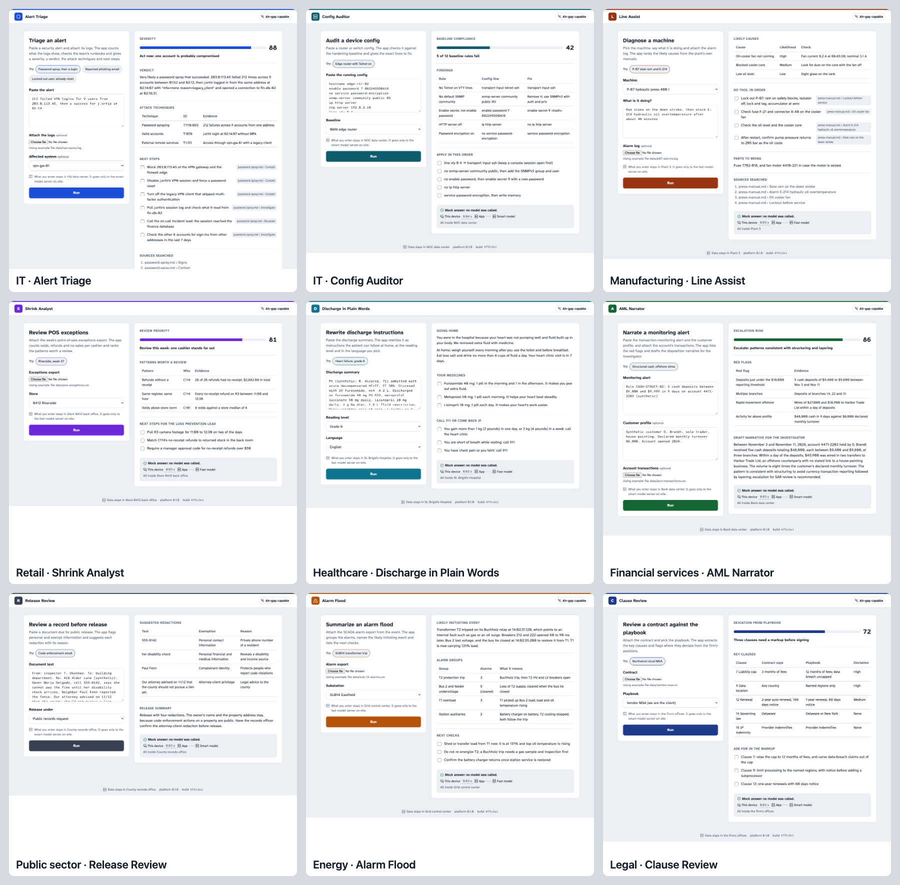

# Gallery: one app per industry, same platform

Each folder is a complete `app/` written only in YAML, Markdown and data (two add a `hooks.py`),
rendered by the unchanged platform in the review layout. Every one passes `make check`
(`tests/test_walkthrough.py` runs them). Screenshots are mock mode: the page, the knowledge search
and the hooks are real; the answer is the example's hand-written `mock:`.

| App | Industry | Model | Inputs | Answer blocks | Extras |
|---|---|---|---|---|---|
| [Alert Triage](../../examples/alert-triage/app) | IT security | smart | textarea, log file, select from CSV | score, text, table, checklist | knowledge, hooks.py |
| [Config Auditor](config-auditor/app) | IT networking | smart | textarea, select | score, table, checklist | |
| [Line Assist](line-assist/app) | Manufacturing | fast, reasoning off | select from CSV, textarea, log file | table, checklist, text | knowledge (cited) |
| [Shrink Analyst](shrink-analyst/app) | Retail | fast | CSV file, select | score, table, checklist | hooks.py computes KPIs |
| [Discharge in Plain Words](discharge/app) | Healthcare | fast, reasoning off | textarea, two selects | text, two checklists | |
| [AML Narrator](aml-narrator/app) | Financial services | smart | two textareas, CSV file | score, table, text | |
| [Release Review](records-release/app) | Public sector | smart | textarea, select | table, text | |
| [Alarm Flood](alarm-flood/app) | Energy | fast, reasoning off | CSV file, select | text, table, checklist | |
| [Clause Review](clause-review/app) | Legal | smart | contract file (.pdf or .txt), select | score, table, checklist | |

Not shown, because the platform does not have them yet: the workspace layout with streamed
answers (the paper's Line Assist), the assistant layout with chat (Floor Help), charts and image
input. These apps use the closest blocks that exist.
