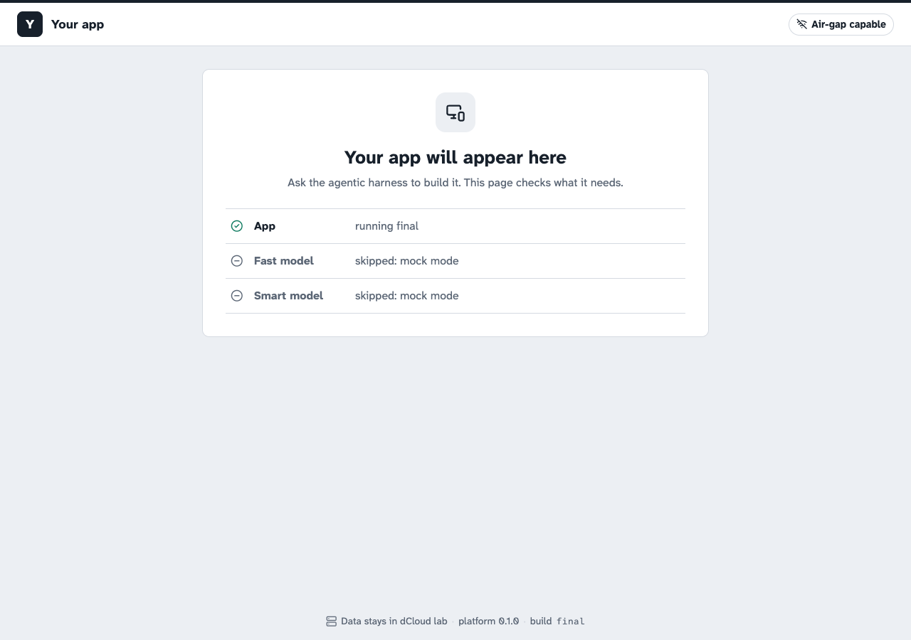
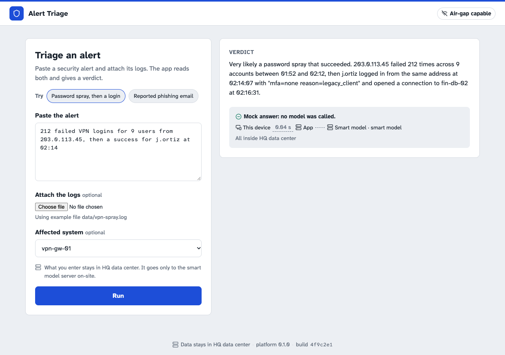
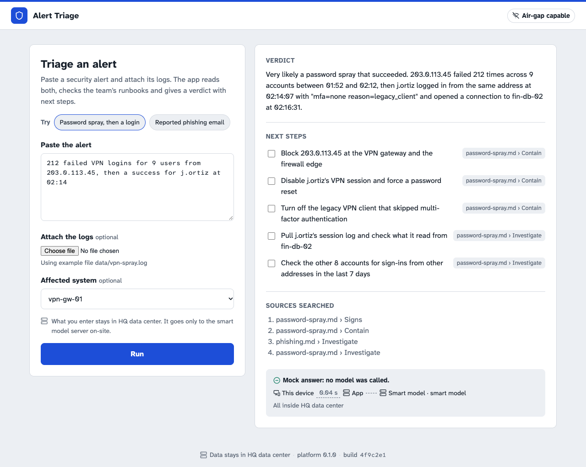
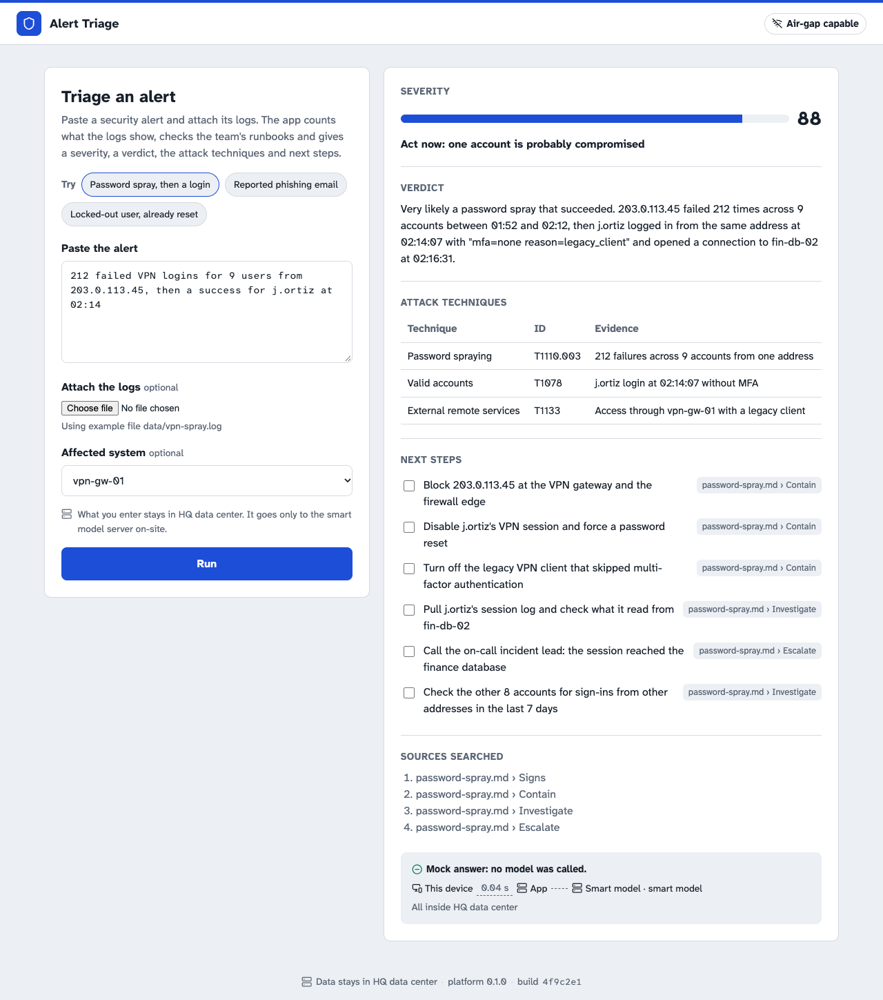
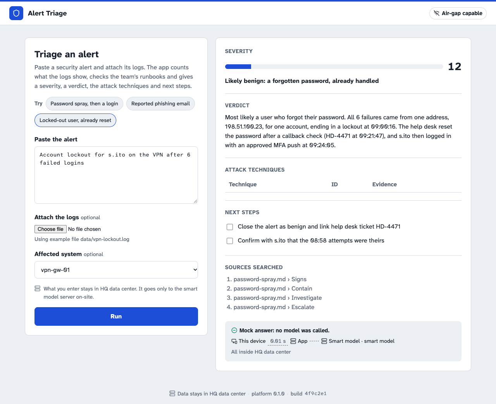

# Walkthrough: a team builds Alert Triage in three prompts

What a team's repo holds at lab start, and what `app/` looks like after each prompt. Every
stage passes `make check`; `tests/test_walkthrough.py` keeps it that way. The screenshots are
the mock model (`LLM_MOCK=1`) answering each screen's first example.

## Step 0: what the team gets at lab start

dCloud automation builds the base image and seeds every team repo with
`scripts/build-team-repo.sh` (the `team-repo/` folder plus a pinned copy of the platform):

```text
team-07/
├── AGENTS.md                      the 9 rules OpenClaw follows
├── skills/base-app/SKILL.md       how to write app/: fields, blocks, recipes, the loop
├── catalog/it-alert-triage.md     the brief prompt 1 names
├── examples/alert-triage/app/     the finished app, to copy patterns from
├── app/
│   └── app.yaml                   name: Team app, screens: []  → the placeholder page
├── Dockerfile                     FROM the base image, COPY app/
├── Makefile                       dev, check, wait, smoke
├── team.env.example               team number, Gitea remote, app URL, model endpoints
├── .gitea/workflows/              build and deploy on push
└── platform/                      read-only copy of the platform for make dev and make check
    ├── baseapp/  requirements.txt  requirements-dev.txt
    └── PIN                        make check fails if platform/ is edited
```

The deployed app shows the placeholder with live checks. On the cluster the model rows are
green or amber; here they are skipped because this is mock mode.



## Step 1: Build

> Build the Alert Triage app from catalog/it-alert-triage.md for the HQ security team.

OpenClaw writes five files in `app/` ([step-1-build/app](step-1-build/app)):

```text
app/
├── app.yaml               name, shield mark, brand #1D4ED8, site HQ data center, screens: [triage]
├── screens/triage.yaml    review layout, smart model; inputs: alert, logs file, asset select;
│                          answer: one text block (verdict); 2 examples with mock answers
├── prompts/triage.md      what the model should say about the alert
└── data/
    ├── assets.csv         6 synthetic systems; feeds the "Affected system" select
    └── vpn-spray.log      233 lines: a spray from 203.0.113.45 and one success
```



What each line of `app.yaml` does, and how a team changes it later: [app-yaml.md](app-yaml.md).

## Step 2: Ground it

> Add our three runbooks to the knowledge folder and cite the step behind each action.

Adds `knowledge/` and a cited checklist ([step-2-ground/app](step-2-ground/app)):

```text
app/
├── knowledge/                          NEW: searched before each answer
│   ├── password-spray.md               Signs, Contain, Investigate, Escalate
│   ├── phishing.md                     Signs, Contain, Investigate, Recover
│   └── malware-beacon.md               Signs, Contain, Investigate, Recover
├── screens/triage.yaml                 + knowledge: knowledge/
│                                       + answer: checklist {key: steps}; mocks gain steps
└── prompts/triage.md                   + "take steps from the runbook passages, cite [n]"
```

```diff
 knowledge: knowledge/
 answer:
   - text: {key: verdict, title: Verdict}
+  - checklist: {key: steps, title: Next steps}
```

Each step's citation chip names the runbook section it came from, and the passages sent to
the model are listed under the answer.



## Step 3: Shape the answer

> Show a severity score, a table of attack techniques and a checklist of next steps.

Adds `hooks.py` and two blocks. This is `examples/alert-triage/app/`, the finished app that
ships in every team repo:

```text
app/
├── hooks.py                  NEW: prepare(ctx) counts failed logins, accounts and sources,
│                             finds a success after failures, looks up the asset's owner and
│                             criticality in data/assets.csv. Standard library only.
├── data/vpn-lockout.log      NEW: the benign case, one user locked out and reset
├── screens/triage.yaml       + score {key: severity}, + table {key: techniques,
│                             columns: [Technique, ID, Evidence]}; third example; mocks reshaped
└── prompts/triage.md         + uses login_summary and asset_info from the hook;
                              describes the four parts and the severity bands
```

```diff
 answer:
+  - score: {key: severity, title: Severity}
   - text: {key: verdict, title: Verdict}
+  - table: {key: techniques, title: Attack techniques, columns: [Technique, ID, Evidence]}
   - checklist: {key: steps, title: Next steps}
```

What the hook adds to the prompt for the spray example; the model gets exact counts instead
of estimating them from 233 log lines:

```text
212 failed logins from 2026-11-24T01:52:08Z to 2026-11-24T02:12:40Z.
Accounts tried: 9 (a.chen, b.okafor, c.lindqvist, d.mensah, e.novak, f.haddad, j.ortiz, k.patel, l.moreau).
Failures by source: 203.0.113.45 (212).
Success after failures: j.ortiz from 203.0.113.45 at 2026-11-24T02:14:07Z mfa=none reason=legacy_client.
```



The benign example scores low, so analysts can see the score moves:



## What OpenClaw runs after each prompt

```text
$ make check
ok    platform/ is unchanged
ok    app.yaml and 1 screen file(s) load
ok    brand #1D4ED8 is readable under white text (6.7:1)
ok    triage: example "Password spray, then a login" runs and renders
ok    triage: example "Reported phishing email" runs and renders
ok    triage: example "Locked-out user, already reset" runs and renders

All checks passed.
$ git add app && git commit -m "..." && git push
$ make wait     # until the Route serves the pushed commit
$ make smoke    # every example against the real smart model, with timings
```
