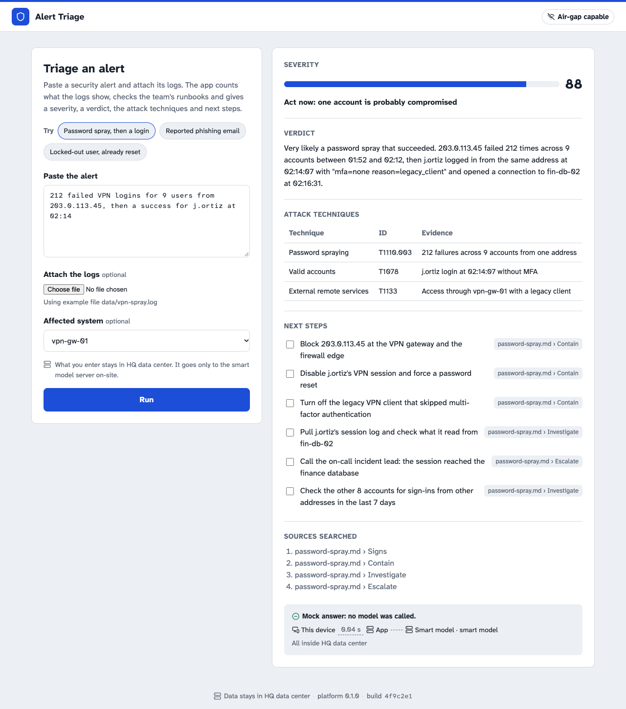

# app.yaml: what you do with it

`app/app.yaml` is the app's identity: its name, its look, where its data stays, and which
screens it has. It is five lines. Lab users normally never type it: they describe the app in
a prompt and the agentic harness writes the file. They can also edit it by hand; the steps are the same.

## At lab start

Every lab user's repo starts with this file. With `screens: []` the app shows the placeholder page.

```yaml
# Your app. The agentic harness fills this in from your first prompt.
name: Your app          # shown in the header, 1 to 40 characters
# mark: shield          # one letter, or an icon from the platform's set
# brand: "#1D4ED8"      # hex color for the mark and header accent
# site: HQ data center  # where data stays, shown in the trust signals
screens: []             # empty shows the placeholder page
```

## After the first prompt

> Build an alert triage app for our HQ security team. An analyst pastes an alert, can attach its
> logs and pick the affected system, and gets a verdict on what happened. Make up sample alerts
> and logs to try it with. Use the Alert Triage brief.

The prompt names no color or mark; the harness takes them from the brief's
[Step 1: Build](../../../catalog/it-alert-triage.md#step-1-build) and replaces the file with:

```yaml
name: Alert Triage
mark: shield
brand: "#1D4ED8"
site: HQ data center
screens: [triage]
```

and writes `screens/triage.yaml` and `prompts/triage.md`, because every name in `screens:`
needs both. After the push the placeholder is gone and `/` opens the Triage screen.

## What each line does

| Line | What the user sees | Where the value came from |
|---|---|---|
| `name: Alert Triage` | The app name in the header and the browser tab | The brief's title |
| `mark: shield` | The square badge left of the name | A security app, so the shield icon. One letter works too, like `mark: T` |
| `brand: "#1D4ED8"` | The header's top border, the mark, the Run button, the score bar | The brief, or your own color |
| `site: HQ data center` | "What you enter stays in HQ data center" under the inputs, "All inside HQ data center" under each answer, and the footer | "for the HQ security team" in the prompt |
| `screens: [triage]` | The pages of the app; the first opens at `/`. With two or more, tabs appear above the screen | One screen per job in the brief |



## Changing it later, one prompt at a time

Each of these prompts changes one line, and the harness runs `make check` before it pushes.

| Prompt | Change in app.yaml |
|---|---|
| "Rename the app to SOC Triage." | `name: SOC Triage` |
| "Use our security team's green, #0E7A5F." | `brand: "#0E7A5F"` |
| "Show a T instead of the shield." | `mark: T` |
| "The data stays in the Frankfurt plant." | `site: Frankfurt plant` |
| "Add a screen for the shift lead that summarizes the day's alerts." | `screens: [triage, shift_summary]`, plus `screens/shift_summary.yaml` and `prompts/shift_summary.md` |

## Editing it by hand

1. Edit `app/app.yaml`.
2. Run `make check`. It must end with `All checks passed.`
3. Run `make dev` and open http://localhost:8742 to see the change, with live reload.
4. Push: `git add app && git commit -m "Rename to SOC Triage" && git push`.
5. Run `make wait`; when it returns, the app URL serves the new version.

## Mistakes make check catches

Every message names the file, the field and the fix:

| Mistake | make check says |
|---|---|
| A light color, `brand: "#FACC15"` | `app/app.yaml: brand #FACC15 is too light for white text (1.5:1, needs 4.5:1); pick a darker color` |
| A color without quotes, `brand: #1D4ED8` | `app/app.yaml: brand: brand is empty; put the color in quotes, like brand: "#1D4ED8", because # without quotes starts a comment` |
| An icon that isn't in the set, `mark: lock` | `app/app.yaml: mark: mark "lock" is not valid; use one letter or one of circle-check, circle-minus, monitor-smartphone, server, shield, triangle-alert, wifi-off` |
| A misspelled field, `sites:` | `app/app.yaml: sites: unknown field "sites"; use one of brand, mark, name, screens, site` |
| A screen listed but not written, `screens: [triage, shift_summary]` | `app/screens/shift_summary.yaml is missing; app.yaml lists screen shift_summary, so add that file` |

If a broken app.yaml is pushed anyway, the app still starts: it shows the placeholder with the
same message in an amber box at the top, so you see what to fix.
